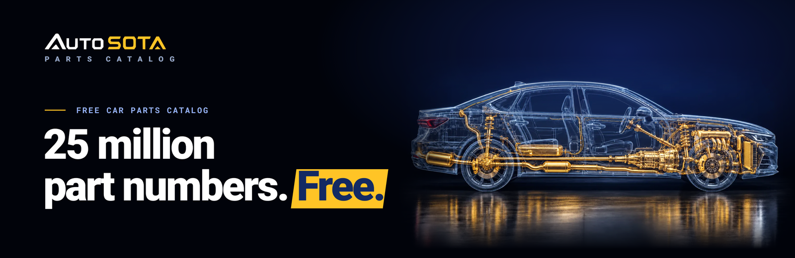
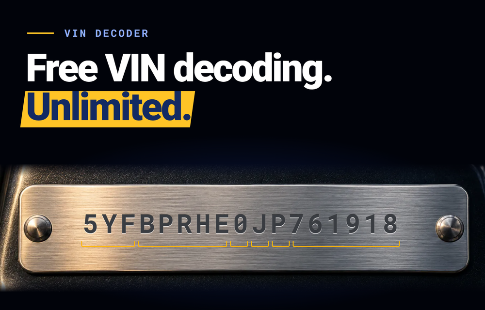
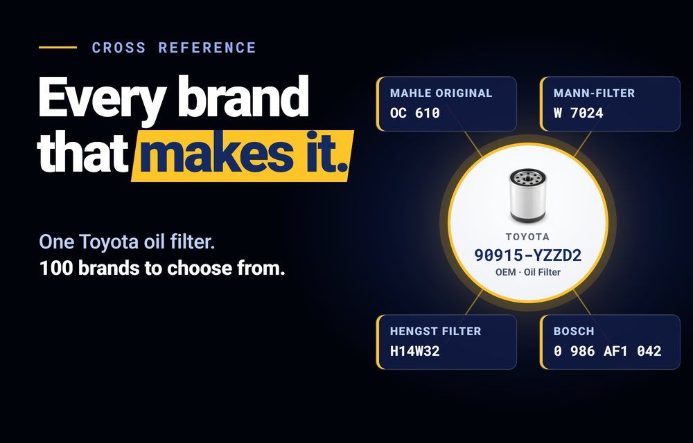
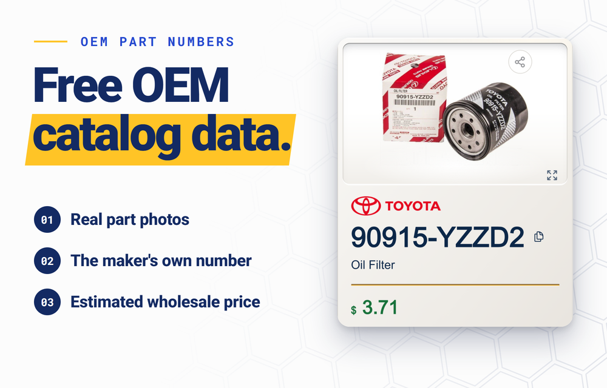
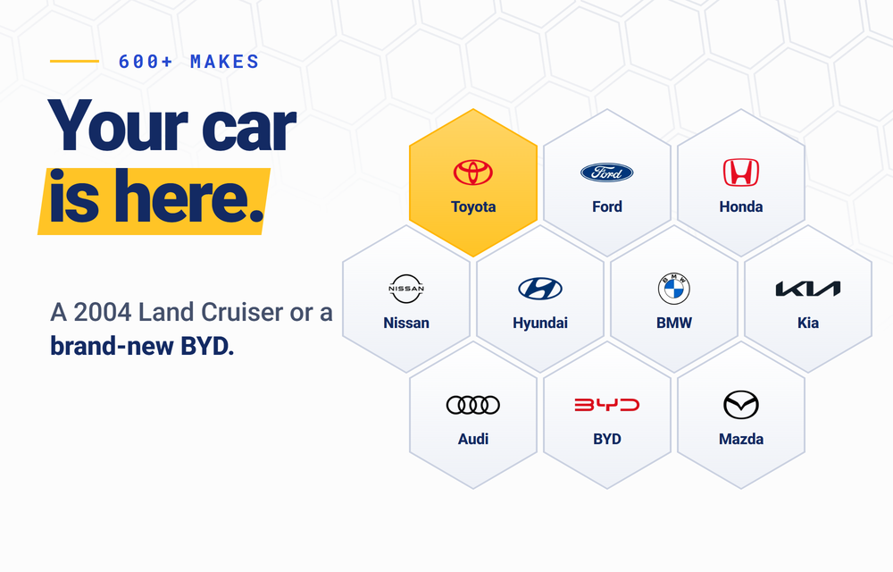

<h1 align="center">The free car parts catalog</h1>

  25 million OEM and aftermarket part numbers · every brand that makes the same part 
  estimated wholesale prices · unlimited VIN decoding 
  <b>No sign-up. No paywall. Nothing to buy.</b>

  
  
  

## Who we are

We are a parts team with 25 years in the trade. Looking up a part always meant jumping between catalogs that were slow, paid, or both, so we built our own for our parts counter. Now it is open to everyone, and thousands of people use it every day.

Auto Sota is a catalog, not a store. Prices are estimates, so you know what a part should cost before you pay for it anywhere.

## What you get

<table>
  <tr>
    <td width="50%"></td>
    <td width="50%"></td>
  </tr>
  <tr>
    <td valign="top"><b>Free VIN decoding, unlimited.</b> Type a VIN and get the exact model, year, engine and plant, then go straight to the parts for that car.</td>
    <td valign="top"><b>Every brand that makes the part.</b> Search a dealer number and see the aftermarket brands that make the same part, side by side on one page.</td>
  </tr>
  <tr>
    <td></td>
    <td></td>
  </tr>
  <tr>
    <td valign="top"><b>Free OEM catalog data.</b> The car maker's own part numbers, with photos, specifications, the cars each part fits and an estimated wholesale price.</td>
    <td valign="top"><b>Your car is here.</b> 600+ makes of cars, trucks and motorcycles. A 2004 Land Cruiser or a brand-new BYD.</td>
  </tr>
</table>

## Start with what you have

| You have | Go to |
|---|---|
| A part number | [Search it](https://autosota.com) or use the [cross reference](https://autosota.com/cross-reference) |
| A VIN | [VIN decoder](https://autosota.com/vin-decoder) |
| Only the car | [Makes and models](https://autosota.com/vehicles) |
| A brand you trust | [Parts brands](https://autosota.com/brands) |
| A type of part | [Parts by category](https://autosota.com/parts) |
| An engine code | [Engines](https://autosota.com/engines) |

## See it on a real part

- [Toyota 90915-YZZD2 oil filter](https://autosota.com/part/toyota/90915yzzd2-oil-filter): one dealer number, 100 brands that make it
- [Mercedes-Benz A0009823208 starter battery](https://autosota.com/part/mercedes-benz/a0009823208-starter-battery)
- [VW 1K0698451K brake pad set](https://autosota.com/part/vag/1k0698451k-brake-pad-set-disc-brake)
- [Hyundai 2630002503 oil filter](https://autosota.com/part/hyundai/2630002503-oil-filter)
- [Spark plug cross reference chart](https://autosota.com/cross-reference/spark-plugs): NGK, Denso, Bosch, Champion and Beru plugs matched to each other
- Brand pages: [Bosch](https://autosota.com/brands/bosch) · [NGK](https://autosota.com/brands/ngk) · [Denso](https://autosota.com/brands/denso)

## Guides

- [How to cross reference OEM part numbers](https://autosota.com/articles/how-to-cross-reference-oem-part-numbers)
- [How to find car parts by VIN](https://autosota.com/articles/how-to-find-car-parts-by-vin)
- [OEM vs aftermarket car parts](https://autosota.com/articles/oem-vs-aftermarket-car-parts)
- How to read part numbers: [Toyota](https://autosota.com/articles/how-to-read-toyota-part-numbers) · [BMW](https://autosota.com/articles/how-to-read-bmw-part-numbers) · [Mercedes-Benz](https://autosota.com/articles/how-to-read-mercedes-benz-part-numbers) · [VW and Audi](https://autosota.com/articles/how-to-read-vw-audi-part-numbers)
- [How brakes really work](https://autosota.com/articles/how-brakes-really-work)

## Recently added

- **List look-up**: paste a whole list of part numbers and get every brand back as one price sheet
- **Check my car**: save your car once and every part page tells you if the part fits it
- **Spark plug cross reference chart** and a cross reference page with worked examples
- **VIN decoder pages by make**: Toyota, Nissan, Honda, Mazda, Mitsubishi and Subaru
- **360° views, fitting videos and maker diagrams** on brand parts
- VW Group factory catalog, plus Chery, BYD, Geely and Renault
- Brembo, Akebono and Fel-Pro catalogs
- Saved parts, recently viewed parts and prices in more currencies

The full list is in [UPDATES.md](UPDATES.md).

## Coming next

- **New languages**: French, Spanish, Portuguese and Arabic
- **Car diagrams**: the car maker's exploded-view drawings for your car, with the parts list for each
- **New catalogs every day**

## Something missing?

It is an early launch and some cars and brands are not in yet. Tell us and we will move it up the list:

- [Request a car, brand or catalog](https://github.com/auto-sota/feedback/issues/new?template=missing.yml)
- [Report wrong data](https://github.com/auto-sota/feedback/issues/new?template=wrong-data.yml)
- [Suggest a feature](https://github.com/auto-sota/feedback/issues/new?template=idea.yml)

## Follow

[X](https://x.com/auto_sota) · [Instagram](https://www.instagram.com/auto.sota/) · [Facebook](https://www.facebook.com/profile.php?id=61596699628809) · [Reddit](https://www.reddit.com/r/autosota/)

---

Auto Sota is independent of vehicle and parts manufacturers. Names and trademarks are used for identification.
